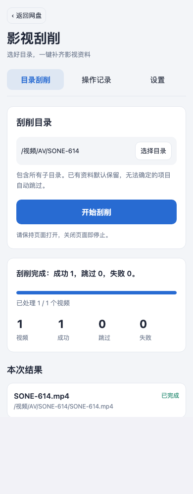

# 影视刮削 0.1.2：同号多来源误跳过修复

日期：2026-11-14。用户反馈标准路径 `/视频/AV/SONE-614/SONE-614.mp4` 也被跳过。核对指定公共 MetaTube 后端后发现，搜索返回的 FANZA 与 JAV321 两条记录番号均为 `SONE-614`。旧版按 `provider + id` 统计来源并要求数量恰好为 1，把同一影片的两个资料源误判成了影片不确定。

## 修复与行为

同号候选保留后端返回顺序，按来源和 ID 去重；依次核验详情，使用首个可用结果。前一来源抛出连接异常、返回 404 或详情不符时，继续尝试下一同号来源。仍然排除不同番号的模糊结果。

同批次同番号的分段复用首次成功的来源。需要重建批次时清空选择并统一重新检查，不将两轮来源混用。所有匹配来源均不可用时记录来源失败，旧批次先停止再执行其余项目，避免把响应丢失但已保存的候选计划误执行。

每次来源尝试前、完成后及异常处理中均检查停止状态；关闭页面后不会再切换来源。目录一键执行、全部分页、既有资料补缺、文件冲突保护和手动重试继续保留。SDK 和宿主执行接口未修改，最低宿主仍为 0.3.10。

## SONE-614 实际验证

公共后端 `https://metatube-server.hf.space/` 的本次实际返回：

| 来源 | 记录 ID | 番号 | 详情 | 海报 |
|---|---|---|---|---|
| FANZA | sone00614 | SONE-614 | HTTP 200，身份一致且含标题 | HTTP 200，JPEG |
| JAV321 | sone00614 | SONE-614 | HTTP 200，身份一致且含标题 | HTTP 200，JPEG |

在身份已核验的真实宿主沙箱中，用合成视频还原用户提供的完整路径，连接上述公共后端并仅点击一次开始。实际结果为成功 1、跳过 0、失败 0，生成同目录 `SONE-614.nfo` 和 `SONE-614.jpg`；视频节点、文件内容版本和位置保持一致。新文件分别符合 1 MiB NFO、2 MiB JPEG 预算。

实际网络请求使用公共 MetaTube，网盘写入使用临时 SQLite、内存 Telegram 和合成素材，未操作用户真实视频。

## 验证基线与检查

- 宿主：干净的 0.3.11 提交 `b69ca6923d098af3683c0c23affa312e5167b9be`，tree `2126bbd8ade7a130053303890a79d850098261b2`。
- 插件基线：`59daeb6e690e9d2ff8e5ef2b59fb593e0d8351d1`；本次修复在未提交工作区中构建，完整集成使用最终根目录五包。
- 工具链：Node.js 22.22.0；显式指定宿主及插件目录，测试前核实 4187 端口空闲和夹具身份。

旧代码运行新增关键回归时出现 7 项失败，其中包括标准 SONE-614 路径、多来源正常采用、第一来源异常／404／错号后的回退和停止后不再切源。修复后 33 项刮削模型及执行器单测全部通过；另外覆盖重建批次后同号来源统一、已保存但响应丢失的旧计划不被执行。

| 命令／检查 | 实际结果 |
|---|---|
| `npm ci` | 退出 0 |
| `npm run check` | 退出 0，严格类型检查与五包独立构建通过 |
| `npm test` | 退出 0，66 个测试文件、694 项通过 |
| `npm run catalog verify ./catalog.json` | 退出 0，五个真实本地包均通过 |
| `sha256sum -c SHA256SUMS` | 退出 0，五包和目录全部通过 |
| 刮削专项 E2E | 8 项通过，零失败、零跳过；含公共后端的 SONE-614 实例和同号第一来源不可用后的回退 |
| `npm run test:e2e -- --reporter=list,json` | 退出 0，最终根目录五包上 82 项全部通过，零失败、零跳过、无重试通过项 |

以上五步分发门禁按表内顺序执行。完整集成显式启用公共 MetaTube、截图和阅读馆五个真实历史包升级用例，实际耗时约 302 秒；结果为 82 项全部通过。

## 分发资产

`apps/media-scraper-0.1.2.tgapp` 为 209,002 字节，SHA256：

`cbfba459550c58f832aec77050f46f8e1c1b210c804682978888e5b4d4bd48eb`

`catalog.json` SHA256：

`62ee7d224a00af4f23dbd41ea2bfda64a223aa1f819a7f4cc60b0f1126eb5218`

五包的源清单、包内清单、摘要和截图逐项一致。其他四款应用包与 0.1.1 发布时的包及目录条目一致。本机日志位于 `.build/scraper-source-fix-20261114/`，不属于公开分发资产。

本轮未修改宿主执行逻辑，也未取消既有资料或文件冲突的保护。来源回退针对获取详情阶段；已开始写入后的海报服务或存储故障仍由宿主返回停止／待核实状态，保留已写入资料供手动重试。未重跑官方飞牛原生界面、真机或真实 Telegram 写入验收。
